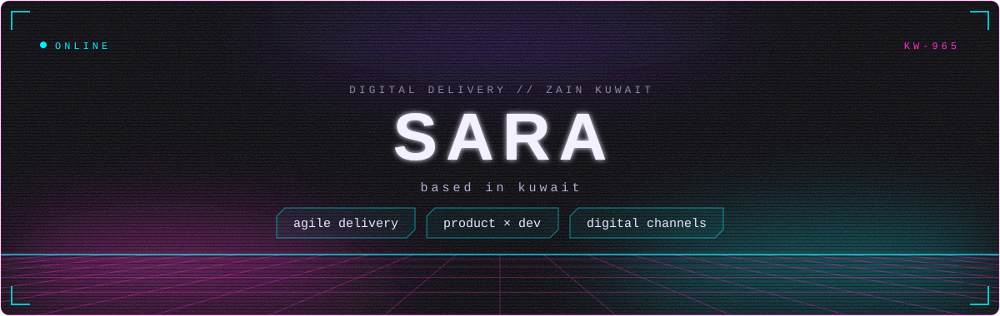
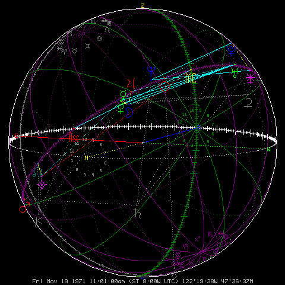
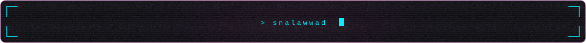

<!-- HEADER -->

<!-- SPHERE -->

<!-- TOOLS -->

<!-- HAND IMAGE -->

<!-- TERMINAL -->

<!-- STREAK STATS -->

  

<!-- NEON ACTIVITY GRAPH -->

  

<!-- CONTRIBUTION SNAKE (made by .github/workflows/snake.yml) -->

  <picture>
    <source media="(prefers-color-scheme: dark)" srcset="https://raw.githubusercontent.com/snalawwad/snalawwad/output/github-snake-dark.svg" />
    
  </picture>

<!-- VISITOR COUNTER -->

  

<!-- FOOTER -->

